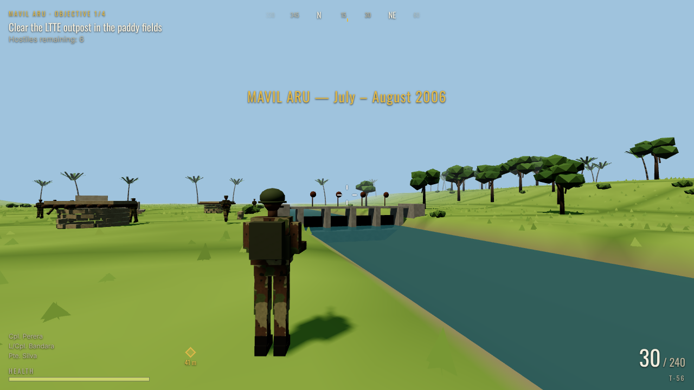
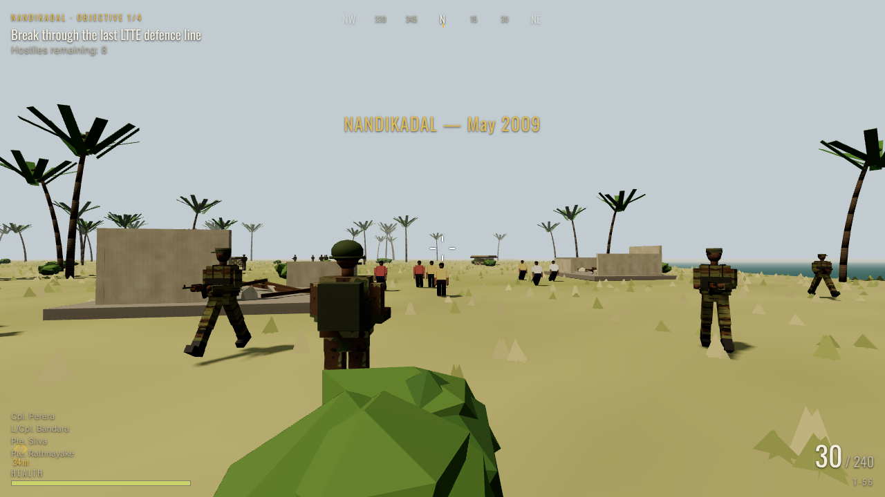
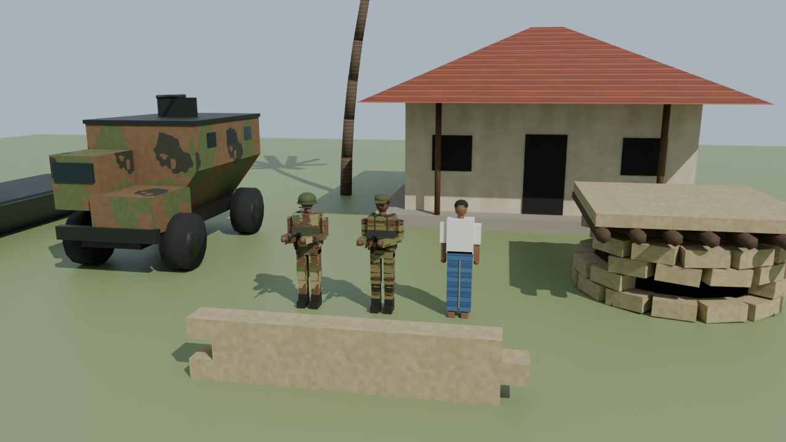

# Wanni Front — Eelam War IV (2006–2009)

**වන්නි සටන් බිම** is a 3D third-person game that runs in the browser. You play a Sri Lanka Army soldier through six real operations from the final phase of the Sri Lankan Civil War. All 3D models are built in **Blender** with a Python script, and the game runs on **Three.js**.



## Campaign

| # | Mission | Date | What happened |
|---|---------|------|---------------|
| 1 | **Mavil Aru** · මාවිල් ආරු | Jul–Aug 2006 | The LTTE closed the anicut's sluice gates on 21 July 2006. Troops reopened them on 8 August, and this is usually seen as the start of Eelam War IV. |
| 2 | **Thoppigala** · තොප්පිගල | Jul 2007 | The LTTE's last eastern stronghold, "Baron's Cap", was captured on 11 July 2007. |
| 3 | **Pooneryn** · පූනරින් | Nov 2008 | Task Force 1 / 58 Division took Nachchikuda's Sea Tiger base, then entered Pooneryn on 15 Nov 2008 (12 GW and 10 GR). |
| 4 | **Kilinochchi** · කිලිනොච්චිය | Nov 2008 – Jan 2009 | Troops broke the earth-bund defences and took the LTTE's administrative centre on 2 Jan 2009. The toppled water tower is in the game. |
| 5 | **Elephant Pass** · අලිමංකඩ | Jan 2009 | The causeway was retaken on 9 Jan 2009, which reopened the A9 land route to Jaffna. |
| 6 | **Nandikadal** · නන්දිකඩාල් | May 2009 | You lead civilians out of the combat zone. The war ended on 18–19 May 2009. |

Each mission has a historical briefing and debrief. The campaign ends with an epilogue that remembers everyone who died: soldiers, LTTE cadres and civilians. Civilians are never targets. Aiming at a civilian and killing them fails the mission.



## Story campaign

You play **Awan**, a fictional officer who starts as a Second Lieutenant. He leads his section — Sgt. Ruwan, Cpl. Nimal, L/Cpl. Kasun, Pte. Prakash — from Mavil Aru (2006) to Nandikadal (2009).

- **Prologue cinematic.** Rain and thunder, a map of Sri Lanka with the six operations, a fly-over that introduces the squad, then the title. You can skip it with the button, Esc, Space or Enter.
- **Radio dialogue.** Every mission has spoken lines (as subtitles) at the start, for each objective, for events like first contact or being wounded, and at the end.
- **Briefings and debriefs** keep the **Historical record** and the **Your section — fiction** text clearly apart.
- **XP, ranks and commendations.** The ranks are Second Lieutenant → Lieutenant → Captain → Major. Only your best result per mission counts, so replaying never doubles XP. When you are promoted, the squad celebrates with kiribath and tea.
- **Menus:** Continue Campaign, New Campaign, Mission Selection, Squad, Player Profile (with reset), Historical Archive (timeline, human cost, sources), Settings (sensitivity, volume, difficulty, graphics) and Credits. Loadout and multiplayer are shown as *planned* and disabled.
- **Epilogue:** a historical timeline, the human cost on every side, where the fictional squad ended up, and a message of remembrance.

The full design and roadmap (new missions, squad orders, weapons, co-op with invite links) are in [`docs/GAME_PLAN.md`](docs/GAME_PLAN.md).

## Testing

```bash
npx playwright install chromium   # once
npm run test:campaign             # a bot plays all six missions in headless Chromium
npm run test:campaign -- 0 3      # only missions 1 and 4
```

The test checks the start screen, prologue skip, every menu screen, each mission's completion, debrief XP, the promotions, the epilogue, saving across a reload, and that there are no page errors.

## Two versions

- **Unity (first-person, IGI-style)**: [`unity/WanniFront`](unity/WanniFront/README.md). Stealth AI with detection meters, camp alarms, watchtowers, binoculars with enemy marking, a tactical map, a T-56 rifle, a suppressed pistol, an SVD sniper rifle and grenades, Unity Terrain with grass, and rain or a different time of day per mission. Open it with Unity 6 LTS and press Play.
- **Web (third-person, Three.js)**: the root of this repo. It runs in any browser and on phones.

Both versions use the same Blender models from `blender/build_assets.py`.

## Gameplay (web version)

- Third-person shooter with a Type 56 (T-56) rifle, aim down sights, recoil, reloading and ammo resupply at supply crates
- Each mission has a chain of objectives: clear areas, reach locations, open the Mavil Aru sluice gates, plant charges on Sea Tiger boats, and escort civilians
- An AI squad follows you and fights with you. LTTE cadres keep watch, alert each other and fight back
- Procedural terrain for paddy fields, jungle, lagoons and the Elephant Pass causeway
- HUD with a compass, an objective waypoint, health and ammo. All sound effects are generated in the browser (Web Audio)
- Three difficulty levels. Progress is saved in your browser
- Touch controls for phones and tablets

**Controls:** `WASD` move · mouse aim · left click fire · right click aim · `Shift` sprint · `R` reload · `E` interact · `Esc` pause

## Running the game

```bash
npm install
npm run dev        # open the printed URL (http://localhost:5173)
npm run build      # production build in dist/ (static, any web host / GitHub Pages)
```

## Blender models



`blender/build_assets.py` builds every model procedurally. It creates the meshes, the camouflage textures (Sri Lanka Army DPM, LTTE tiger-stripe), the materials and the named joints for animation. It then saves:

- `blender/models/*.blend`, the editable Blender files. Open them in Blender to change a model.
- `public/models/*.glb`, the files the game loads.

The models are: SL Army soldier, LTTE cadre, civilian, Unibuffel-style APC, Sea Tiger attack boat, sandbag bunker, sandbag wall, earth bund, house, ruined house, Kilinochchi water tower (toppled), Mavil Aru anicut, coconut palm, palmyrah palm, jungle tree, bush, rocks (including Thoppigala's Baron's Cap) and a supply cache.

To rebuild all models:

```bash
blender -b -P blender/build_assets.py      # with Blender 4.x/5.x installed
# or, without the Blender app:
pip install bpy && python blender/build_assets.py
```

Soldiers face −Y in Blender and are made of parts named `Torso`, `Head`, `ArmL`, `ArmR`, `LegL`, `LegR` and `Muzzle`. The game animates these parts directly, so if you edit a soldier in Blender, keep those names.

## Project layout

```
blender/build_assets.py   Blender model builder
blender/models/           editable .blend files
public/models/            exported .glb models
src/main.js               game loop, player, camera, objectives, HUD
src/missions.js           the six missions: history text, maps, objectives
src/world.js              terrain, water, props, collision and ray casts
src/units.js              soldiers and civilians: animation and AI
src/fx.js, src/audio.js   effects and procedural sound
src/input.js              keyboard, mouse and touch controls
```

## Historical sources

- [Eelam War IV](https://en.wikipedia.org/wiki/Eelam_War_IV)
- [Northern Theatre of Eelam War IV](https://en.wikipedia.org/wiki/Northern_Theatre_of_Eelam_War_IV)
- [Eastern Theatre of Eelam War IV](https://en.wikipedia.org/wiki/Eastern_Theatre_of_Eelam_War_IV)
- [Battle of Kilinochchi (2008–2009)](https://en.wikipedia.org/wiki/Battle_of_Kilinochchi_(2008%E2%80%932009))
- [58 Division (Sri Lanka)](https://en.wikipedia.org/wiki/58_Division_(Sri_Lanka))
- [List of military operations of the Sri Lankan civil war](https://en.wikipedia.org/wiki/List_of_military_operations_of_the_Sri_Lankan_civil_war)
- [Sunday Observer — "Pooneryn falls" (16 Nov 2008)](https://archives.sundayobserver.lk/2008/11/16/sec03.asp)
- [South Asia Intelligence Review (SATP)](https://satp.org/satporgtp/sair/Archives/7_30.htm)

The gameplay is fiction built around these events. Many sources from 2008–2009 are official or government-aligned, and the final months of the war are still the subject of calls for accountability. The game's text sticks to well-documented dates and places.
